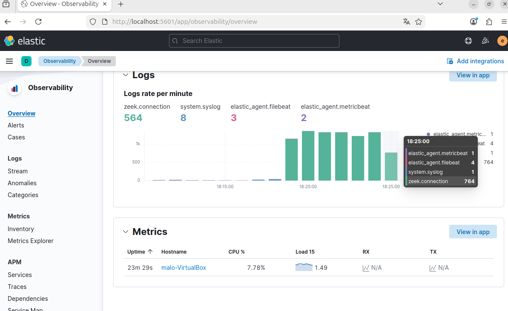
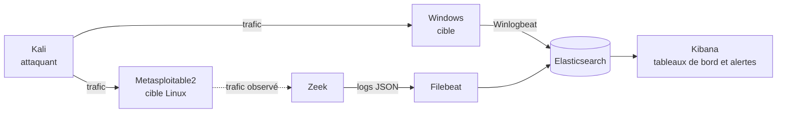
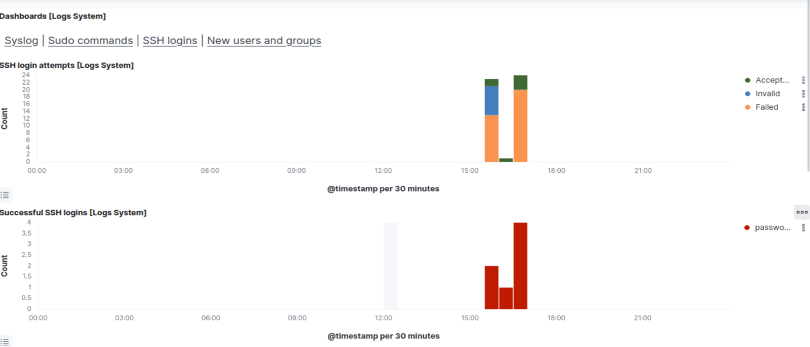
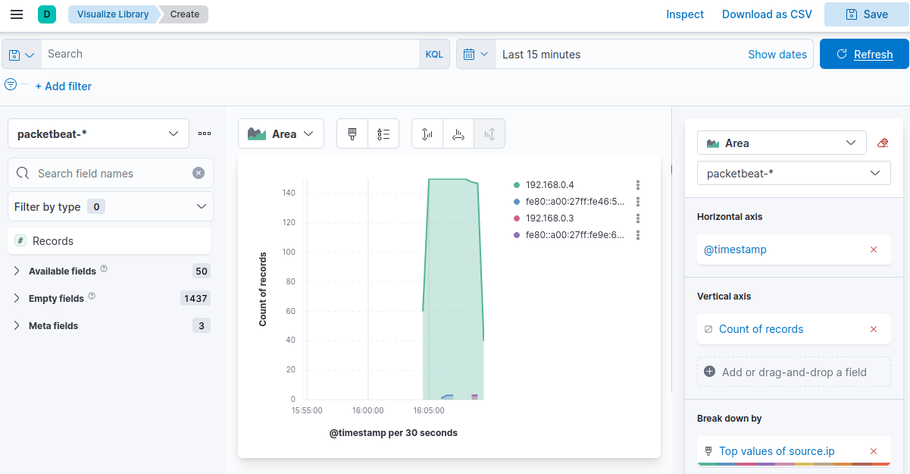
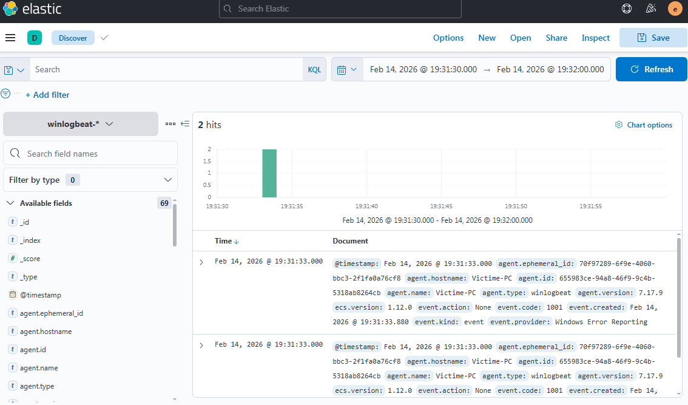

# Lab SOC : détection d'attaques avec Zeek et Elastic

Un SIEM de laboratoire qui collecte les logs réseau (Zeek) et système (Linux, Windows),
les centralise dans Elasticsearch, et détecte trois attaques courantes avec des règles
reliées à MITRE ATT&CK.

Projet issu d'un lab de forensics réalisé en binôme à JUNIA ISEN (M1 Cybersécurité)
avec Mohamed Bachir ALI SEINI OUMAR, puis repris ici sous forme reproductible.



## Ce que le lab détecte

| Attaque | Log source | Règle | MITRE ATT&CK |
|---|---|---|---|
| Brute force SSH | Zeek `ssh.log` | [ssh_bruteforce.yml](detections/ssh_bruteforce.yml) | T1110.001 |
| Injection SQL | Zeek `http.log` | [sqli_http.yml](detections/sqli_http.yml) | T1190 |
| Flood ICMP | Zeek `conn.log` | [icmp_flood.yml](detections/icmp_flood.yml) | T1498.001 |

Les règles sont au format [Sigma](https://sigmahq.io/), donc convertibles vers Elastic,
Splunk ou un autre SIEM.

## Architecture



## Aperçu

Brute force SSH : les échecs s'accumulent, puis une connexion réussit.



Flood ICMP : pic de trafic provenant d'une seule adresse source.



Événements du poste Windows remontés par Winlogbeat :



## Démarrage

Sur la VM Linux de supervision, avec Docker installé :

```bash
cp .env.example .env
```

Modifiez `.env` (mots de passe, clé de chiffrement, interface réseau), puis :

```bash
docker compose up -d
```

Kibana est ensuite accessible sur `http://localhost:5601` avec le compte `elastic`.

## Contenu du dépôt

| Dossier | Contenu |
|---|---|
| [docker-compose.yml](docker-compose.yml) | Zeek, Filebeat, Elasticsearch et Kibana |
| [detections/](detections/) | Règles Sigma |
| [dashboards/](dashboards/) | Exports des tableaux de bord Kibana |
| [scenarios/](scenarios/) | Scénarios joués pour valider chaque règle |
| [reports/](reports/) | Rapports d'incident |
| [docs/screenshots/](docs/screenshots/) | Captures d'écran du lab |

## Avertissement

Ce lab est destiné à un réseau isolé de machines virtuelles dont vous êtes responsable.
Les mots de passe de `.env.example` sont des exemples à remplacer.
